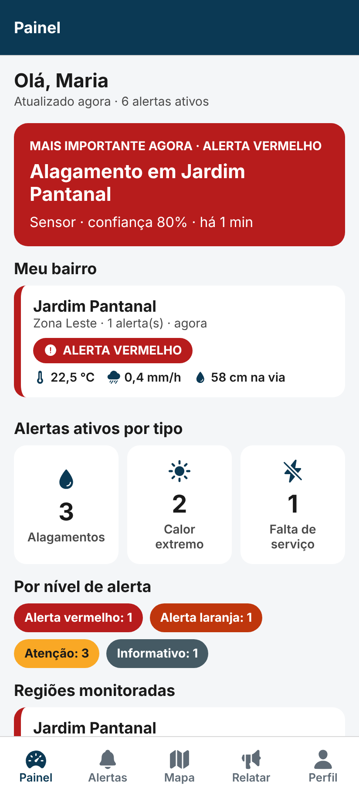
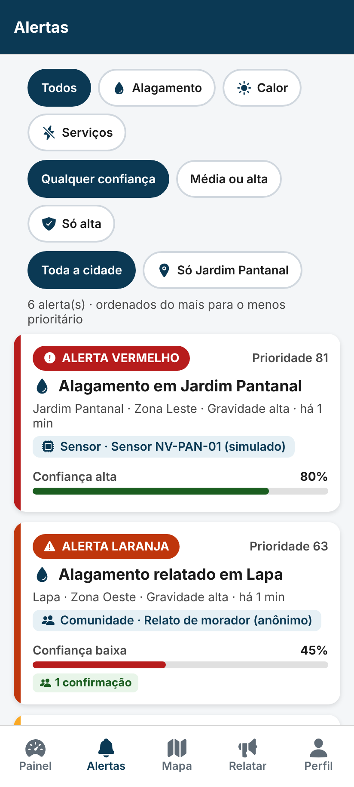
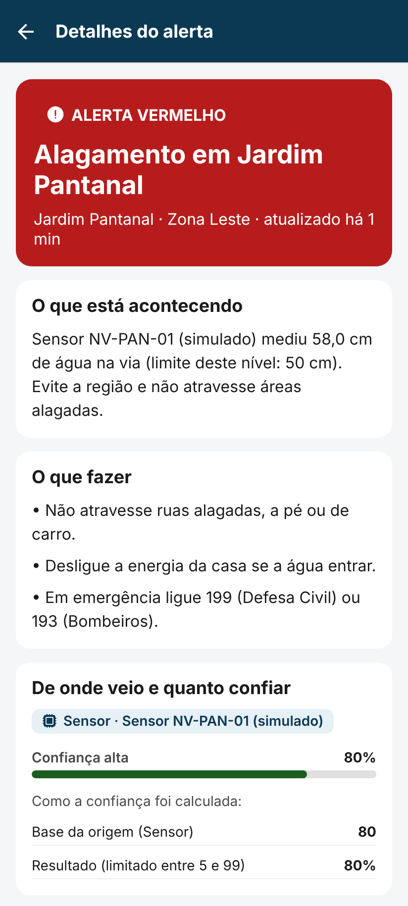
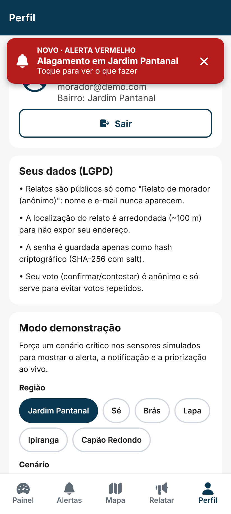
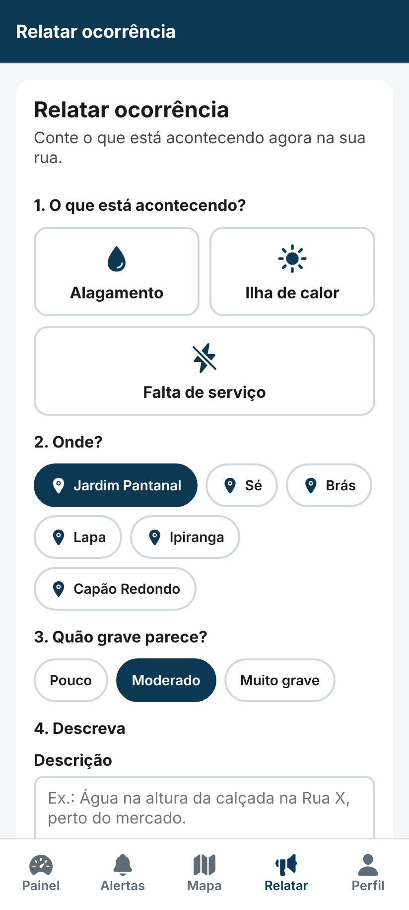
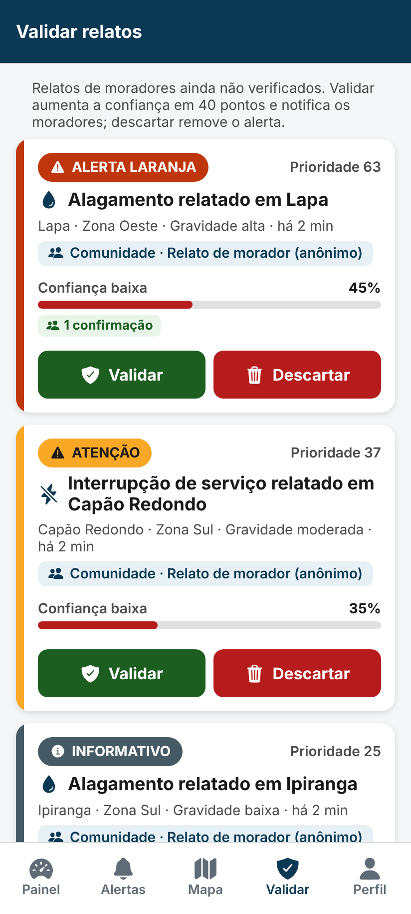

# Urban Risk Intelligence Platform: App Mobile (React Native)

**Global Solution 2026.2 · Advanced Programming & Mobile Dev · 3º ano de Engenharia da Computação**

| Integrante | RM |
|---|---|
| Arthur Bergamaço Alves | RM 556207 |
| Leonardo Medeiros da Silva | RM 559220 |

Este é o app em **React Native (Expo + TypeScript)** que consome a API Spring Boot da pasta [`../backend`](../backend). Visão geral do projeto: [README principal](../README.md). Moradores e agentes locais usam o app para acompanhar alagamentos, ilhas de calor e interrupções de serviços essenciais em São Paulo.

| Painel | Alertas | Detalhe | Notificação |
|---|---|---|---|
|  |  |  |  |

| Relatar (morador) | Validar (agente) |
|---|---|
|  |  |

---

## 1. Como rodar

**Pré-requisito:** o backend precisa estar rodando em `http://localhost:8080` (veja [`../backend/README.md`](../backend/README.md)).

```bash
cd mobile
npm install
npm run web        # abre no navegador (forma principal de teste)
# ou: npm start  -> Expo Go no celular / emulador Android
```

Contas de teste (senha **123456**):

- Morador: `morador@demo.com`
- Agente local: `agente@demo.com`

Endereço do backend em `src/services/api.ts`:

| Onde o app roda | Endereço |
|---|---|
| Navegador e iOS Simulator | `localhost` (padrão) |
| Emulador Android | `10.0.2.2` (já tratado automaticamente) |
| Celular físico | troque pelo IP do computador, ex.: `http://192.168.0.10:8080` |

## 2. Como cada requisito foi atendido

| Requisito do enunciado | Como está no app |
|---|---|
| Consumir a API REST | `src/services/*.ts` com **axios**. Uma função por endpoint. |
| **Painel de acompanhamento** | Aba **Painel**: alerta mais importante, "Meu bairro", totais por tipo e por nível, situação de cada região (temperatura, chuva, nível da água), **indicadores** (tempo de atualização, qualidade dos alertas, facilidade de uso) e **status das fontes de dados**. Atualiza sozinho a cada 20 s. |
| **Lista ou mapa de eventos** | Os dois. Aba **Alertas** (lista com filtros por tipo, confiança e bairro) e aba **Mapa** (pontos coloridos por nível e áreas das regiões). |
| **Alertas priorizados** | A lista segue a ordem de prioridade calculada pela API. Cada card mostra o nível (vermelho/laranja/amarelo/informativo) e a prioridade de 0 a 100. |
| **Análise para priorização** | Cada alerta mostra a **tendência** (piorando, estável ou melhorando) e a previsão ("deve atingir nível ALTA em ~4 min"), calculadas pelo backend com regressão linear. O detalhe mostra **por que o alerta tem aquela prioridade**, parcela por parcela. |
| **Origem e nível de confiança** | Todo card tem o chip de **origem** (Sensor, Base pública ou Comunidade, com o nome da fonte) e a **barra de confiança**. O detalhe mostra **como a confiança foi calculada**, linha por linha. |
| **Notificações de alerta** | Duas formas. (1) **Notificação do sistema**: no celular via `expo-notifications`, no navegador via Notification API. (2) **Banner dentro do app**, visível em qualquer aba. |
| **Moradores e agentes locais** | O **morador** envia relatos e confirma ou contesta alertas. O **agente local** valida ou descarta relatos e marca ocorrências como resolvidas. As abas mudam conforme o perfil. Também dá para entrar **só para ver**, sem conta. |
| **Simples, acessível, fácil de usar** | Ver seção 4. |

## 3. Telas

| Tela | Arquivo | O que faz |
|---|---|---|
| Início | `screens/auth/InicioScreen.tsx` | Apresentação, entrar, criar conta, entrar só para ver, status do servidor |
| Entrar / Criar conta | `screens/auth/LoginScreen.tsx`, `CadastroScreen.tsx` | Login e cadastro (morador ou agente com código; bairro opcional) |
| Painel | `screens/principal/PainelScreen.tsx` | Visão geral da cidade |
| Alertas | `screens/principal/AlertasScreen.tsx` | Lista priorizada com filtros |
| Mapa | `MapaScreen.web.tsx` (navegador) e `MapaScreen.tsx` (celular) | Eventos no mapa |
| Detalhe | `screens/EventoDetalheScreen.tsx` | Descrição, o que fazer, origem e cálculo da confiança, gráfico das últimas leituras, ações |
| Relatar | `screens/principal/NovoRelatoScreen.tsx` | Morador relata em 4 passos: tipo, bairro, gravidade e descrição |
| Validar | `screens/principal/ValidarScreen.tsx` | Fila de relatos pendentes para o agente |
| Perfil | `screens/principal/PerfilScreen.tsx` | Dados do usuário, explicação de LGPD e **modo demonstração** |

## 4. Acessibilidade e facilidade de uso

- **A cor nunca aparece sozinha.** Todo nível de alerta tem cor, ícone e texto ("ALERTA VERMELHO"), para quem tem daltonismo.
- **Contraste** mínimo de 4,5:1 (WCAG AA) entre texto e fundo. As cores estão em `styles/theme.ts`.
- **Áreas de toque** de no mínimo 48 px e fontes de 14 px ou mais. O app respeita o tamanho de fonte do sistema.
- **Leitor de tela:** `accessibilityLabel`, `accessibilityRole` e `accessibilityHint` nos botões, cards e seletores. O banner de alerta usa `accessibilityLiveRegion="assertive"`, então é anunciado sozinho.
- **Linguagem simples:** "Muito grave", "Você está vendo isso?", "O que fazer". Cada tipo de risco traz orientações e os telefones 199 e 193.
- **Retorno na própria tela**, em vez de `Alert.alert`, que não funciona no navegador.
- Estados de **carregando, erro de conexão e lista vazia** padronizados, com o botão "Tentar novamente".

## 5. Notificações: como funcionam

`src/hooks/useMonitorAlertas.ts`:

1. A cada 15 s, o app chama `GET /alertas/novos?desde=<horário do servidor>`.
2. A API devolve só os alertas **laranja ou vermelho** com confiança **média ou alta** que surgiram ou pioraram desde a última consulta.
3. Para cada um, o app:
   - mostra a **notificação do sistema**. O Metro escolhe automaticamente `notificacaoService.ts` no celular ou `notificacaoService.web.ts` no navegador;
   - coloca o alerta no **banner** do topo. Tocar no banner abre o detalhe.

No navegador, aceite a permissão de notificações quando ela for pedida. Se recusar, o banner continua funcionando.

## 6. Quando o backend cai (resiliência)

Arquivos: `src/context/ConexaoContext.tsx` e `src/components/FaixaConexao.tsx`.

- O app verifica `GET /health` a cada 5 s, e a cada 3 s quando está offline, para reconectar rápido. Além disso, **qualquer requisição que falhe por rede** marca offline na hora, via interceptor do axios em `services/api.ts`.
- Offline, aparece em qualquer tela a faixa vermelha **"Sem conexão com o servidor"**, com o número da tentativa, o tempo offline e o botão **"Tentar agora"**.
- As telas **mantêm os últimos dados recebidos** em vez de ficarem vazias. As requisições têm timeout de 8 s, então nada fica "preso".
- Quando o backend volta, aparece a faixa verde **"Conexão restabelecida"** e **todas as telas recarregam sozinhas** (`useRecarregarAoReconectar`). Alertas graves que surgiram durante a queda são notificados na volta, porque o monitor continua de onde parou.

## 7. Mapa no navegador e no celular

O `react-native-maps` não funciona na web. Por isso existem dois arquivos com o mesmo nome:

- `MapaScreen.web.tsx`: **Leaflet + OpenStreetMap** (gratuitos, sem chave de API), usado no navegador;
- `MapaScreen.tsx`: **react-native-maps**, usado no Android e no iOS.

O Metro escolhe o arquivo certo sozinho, e o resto do app importa só `MapaScreen`. Os dados vêm do mesmo hook, `hooks/useDadosMapa.ts`.

## 8. Testes

```bash
npm test
```

Testes com **Jest** (`jest-expo`) em `src/__tests__/`:

- formatação de datas e números;
- posição dos marcadores no mapa;
- cálculo das parcelas da prioridade (mesma fórmula do backend);
- tratamento das mensagens de erro da API.

## 9. Estrutura do projeto

Segue o padrão usado nas aulas:

```
App.tsx                      → navegação raiz (Início/Login ou área principal)
src/
  navigation/                → tipos das rotas + MainTabs (abas e banner de alerta)
  screens/                   → telas (auth/, principal/ e detalhe)
  components/                → componentes reutilizáveis (AlertaCard, BadgeNivel, BarraConfianca...)
  services/                  → chamadas à API (axios) e notificações
  hooks/                     → useMonitorAlertas, useDadosMapa
  context/                   → SessaoContext (usuário logado)
  interfaces/ e types/       → tipagem TypeScript dos dados da API
  styles/                    → StyleSheets separados da lógica + theme.ts
  utils/                     → formatação, erros da API, prioridade, helpers do mapa
  __tests__/                 → testes Jest
```

## 10. Roteiro de demonstração

1. Entre como `morador@demo.com`. O painel mostra o alerta vermelho do **Jardim Pantanal** (sensor de nível da água).
2. Vá em **Perfil → Modo demonstração**, escolha *Sé + Alagamento* e toque em **Simular evento**. Em até 15 s chegam o **banner** e a **notificação**.
3. Na aba **Relatar**, envie um alagamento na Sé. A confiança inicial do relato já é 50%, porque o sensor da Sé confirma o mesmo risco.
4. Abra o alerta e veja **como a confiança foi calculada**.
5. Saia e entre como `agente@demo.com`. Na aba **Validar**, valide um relato (+40 de confiança, e os moradores são notificados) ou descarte.
6. **Pare o backend** (Ctrl+C no terminal dele). A faixa "Sem conexão" aparece e o app continua navegável com os últimos dados. **Suba o backend de novo**: aparece "Conexão restabelecida" e tudo se atualiza.
